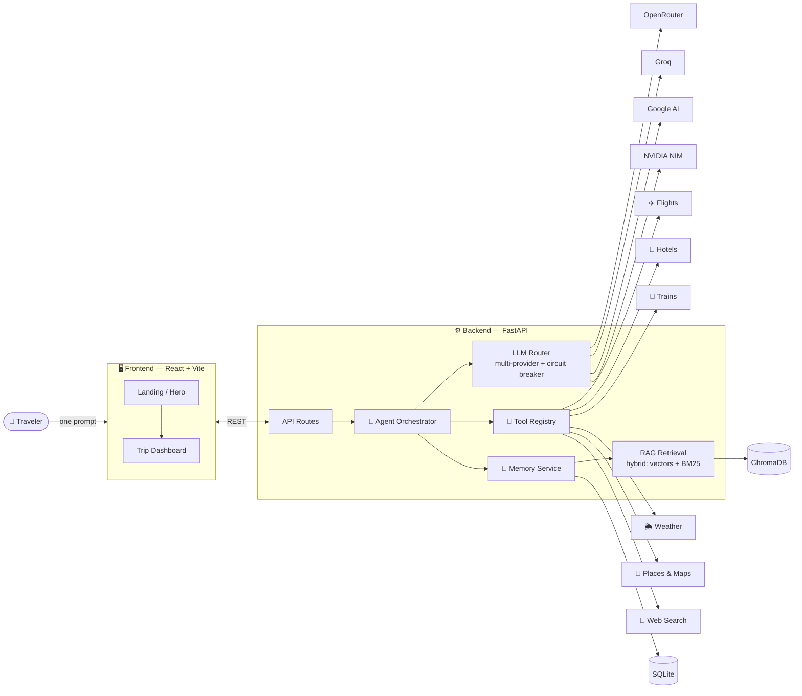

<div align="center">

# ✈️ TRIP-AI

### *Where will you go next?*

**An AI travel agent that turns one sentence into a full, personalized itinerary** — flights, hotels, trains, restaurants, weather, and maps, orchestrated by a multi-LLM agent with RAG-powered memory.


</div>

---

> 💬 *"I'm planning a 7-day trip to Japan in October. I love food, hidden cafes, scenic hikes, and want to avoid crowds..."*
>
> That's all it takes. TRIP-AI does the rest.

---

## 🧠 How it works



**The flow:** you describe your trip in plain language → the **orchestrator** breaks it into tasks → the **LLM router** picks the best available model (with automatic failover via circuit breakers) → **tools** fetch live flight/hotel/train/weather data → **RAG memory** recalls your preferences across the session → out comes a personalized, day-by-day itinerary.

## ✨ Highlights

| | Feature | What it means |
|---|---|---|
| 🤖 | **Multi-LLM routing** | OpenRouter, Groq, Google AI Studio & NVIDIA NIM behind one router — if a provider is down or rate-limited, a circuit breaker fails over automatically |
| 🧰 | **Live travel tools** | Real flight, hotel, train, restaurant, weather, geocoding & web-search APIs, all pluggable via a tool registry |
| 🧠 | **Session memory + RAG** | Hybrid retrieval (sentence-transformer embeddings in ChromaDB + BM25 keywords) so the agent remembers *"avoid crowds"* on day 6 |
| 🔐 | **Secrets done right** | Every key is a pydantic `SecretStr` loaded from `.env` — nothing reads `os.environ` directly, nothing leaks into logs |
| 🪶 | **Graceful degradation** | Missing an API key? The related tool switches off — the rest of the app keeps working |
| 🗺️ | **Interactive maps** | MapLibre GL rendering of your itinerary |

## 📁 Project structure

```
TRIP-AI/
├── 📄 .env.example          # every supported API key, documented
│
├── ⚙️ Backend/               # FastAPI + agent brain (Python)
│   ├── app/
│   │   ├── main.py          #   app entrypoint, CORS, lifespan
│   │   ├── config.py        #   all settings & secrets (pydantic-settings)
│   │   ├── api/             #   REST endpoints (/session, /plan, /health)
│   │   ├── agent/           #   🤖 orchestrator — the planning loop
│   │   ├── llm/             #   provider adapters, router, circuit breaker,
│   │   │                    #     role prompts, structured output
│   │   ├── tools/           #   flights · hotels · trains · weather ·
│   │   │                    #     places · maps · websearch (+ registry, cache)
│   │   ├── memory/          #   session memory models & service
│   │   ├── rag/             #   corpus + hybrid retrieval (Chroma ∪ BM25)
│   │   └── storage/         #   SQLite persistence
│   ├── tests/               #   pytest suite
│   └── requirements.txt
│
└── 🖥️ frountend/             # React 18 + Vite + Tailwind (TypeScript)
    ├── src/
    │   ├── components/
    │   │   ├── landing/     #   hero with ambient video background
    │   │   ├── loading/     #   itinerary-generation loader
    │   │   └── dashboard/   #   trip dashboard, chat bar, views
    │   ├── api/client.ts    #   typed backend client
    │   └── data/mock.ts
    └── public/videos/       #   background media
```

## 🚀 Quick start

### Prerequisites
- **Python 3.11+** · **Node 18+**

### 1 · Clone & configure

```bash
git clone https://github.com/lukan-lawslaf/TRIP-AI.git
cd TRIP-AI
cp .env.example .env   # then paste in the API keys you have
```

### 2 · Backend (port 8000)

```bash
cd Backend
python -m venv .venv
.venv\Scripts\activate        # Windows   (macOS/Linux: source .venv/bin/activate)
pip install -r requirements.txt
python -m uvicorn app.main:app --reload --port 8000
```

### 3 · Frontend (port 5173)

```bash
cd frountend
npm install
npm run dev
```

Open **http://localhost:5173**, type where you want to go, and hit **Plan My Trip**. 🎒

### 🔍 Useful endpoints

| Endpoint | What it does |
|---|---|
| `GET /health` | Liveness check |
| `GET /health/models` | Which LLM providers are currently healthy |
| `POST /session` | Start a planning session |
| `POST /session/{id}/message` | Chat with the agent |
| `POST /session/{id}/plan` | Generate the full itinerary |

## 🧪 Tests

```bash
cd Backend
pytest
```

---

<div align="center">

**Built with FastAPI · React · ChromaDB · and a lot of wanderlust** 🌍

*Tell our AI where you're going and what you love — we'll create a personalized itinerary for you.*

</div>
